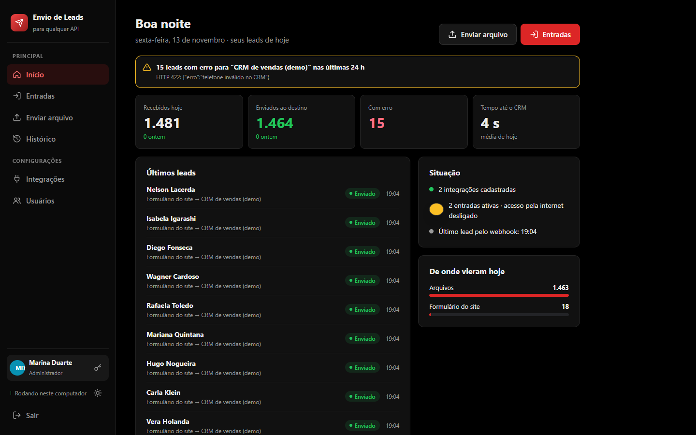
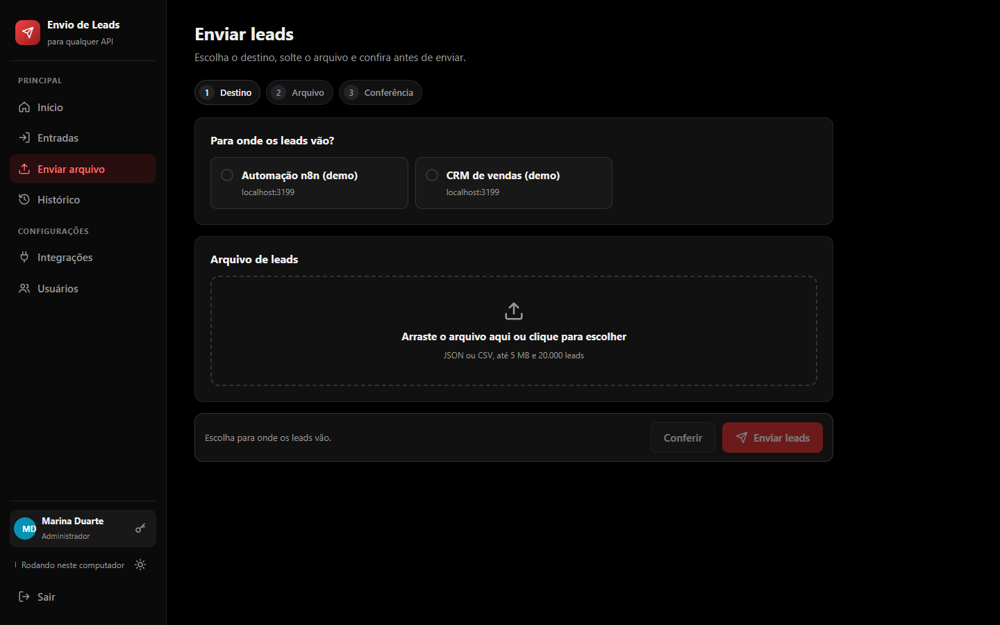
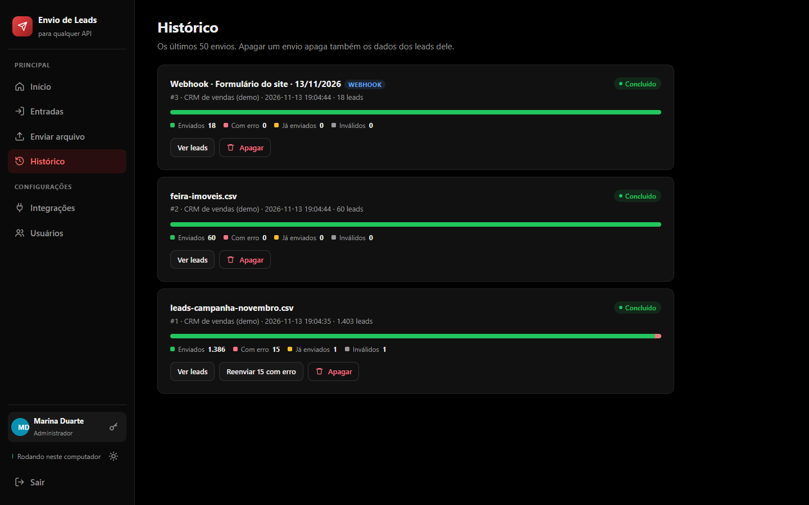
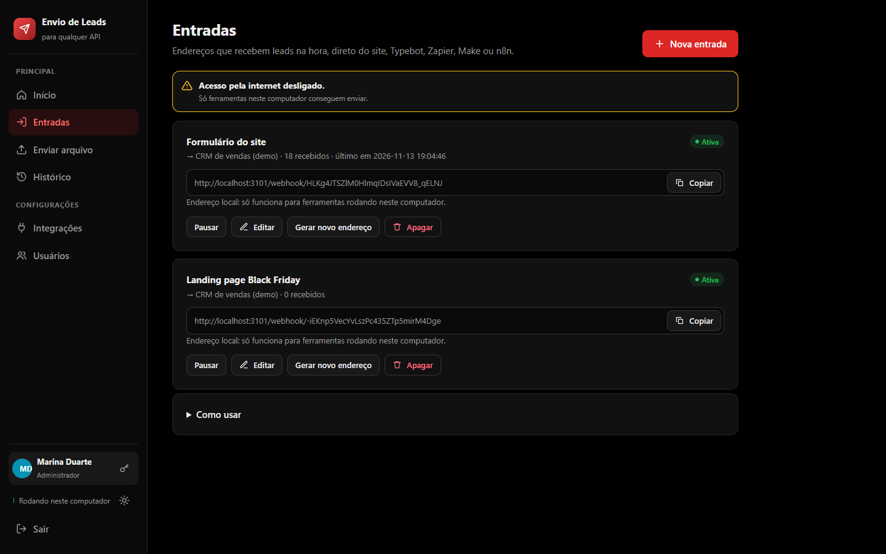
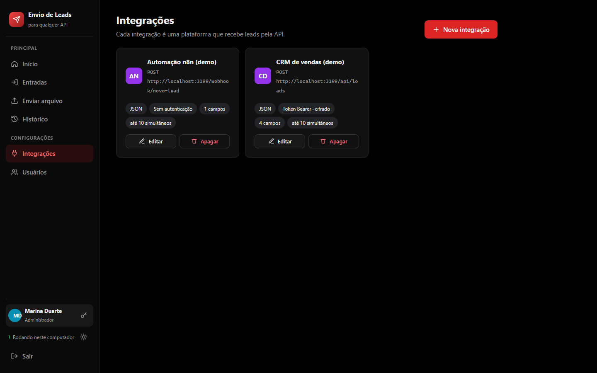

# Envio de Leads — leads da planilha ao CRM em segundos

> 🇧🇷 Português · [🇺🇸 English below](#english)

Ferramenta que pega leads de **planilhas (CSV/JSON)**, **formulários** e **webhooks** e envia para **qualquer plataforma com API**:
CRMs, Zapier, Make, n8n ou um sistema próprio. Acaba com o trabalho de cadastrar lead por lead e com o atraso entre o lead
chegar e o vendedor ligar.

Esta é a **vitrine** do projeto. O código-fonte é privado. Todos os dados das imagens são **fictícios**, e o "CRM" dos prints é uma API simulada.

## Que problema resolve

- **Antes:** a equipe baixava a planilha da campanha e cadastrava cada lead no CRM à mão, ou mandava um por vez com pausa fixa.
  Na primeira versão, 1.400 leads levavam **cerca de 20 minutos**.
- **Agora:** o envio é **em paralelo** (10 simultâneos por padrão), com freio automático se o destino reclamar.
  Na medição com uma API simulada, 1.400 leads passaram a levar **menos de 1 minuto, sem erro nem duplicado**.
  Na demo destes prints, foram ~9 s.
- **Lead de formulário chega na hora:** cada **Entrada** tem um endereço secreto de webhook. O lead do site, do Typebot ou da landing page
  vai para o CRM em segundos, mesmo durante o envio de uma planilha.

## Telas

| Enviar arquivo (destino → arquivo → conferência) | Histórico com reenvio só dos erros |
|---|---|
|  |  |

| Entradas (webhook) | Integrações configuráveis |
|---|---|
|  |  |

## O que faz

- **Qualquer API:** URL, método, autenticação (Bearer, cabeçalho ou Basic), JSON ou formulário, e **mapeamento de campos** com modelos
  (`{"phone": "{{celular}}", "source": "{{origem|Planilha}}"}`). Há modelos prontos para CRM, webhook e automações.
- **Prévia antes de enviar:** mostra quantos leads são válidos, repetidos ou inválidos e como o primeiro vai chegar ao destino.
- **Sem duplicados:** quem já foi enviado não vai de novo, nem se o mesmo arquivo for enviado duas vezes.
- **Erros tratados:** tenta de novo quando o destino falha por pouco tempo (503), separa o que foi recusado e permite **reenviar só os erros**.
- **Início com os números do dia:** leads recebidos, enviados, com erro, tempo médio até o CRM, origens e últimos leads.
- **Acesso pela internet** para as Entradas, por túnel (Cloudflare ou ngrok com endereço fixo). Só a porta do webhook fica exposta, nunca o painel.
- **Usuários:** login, administrador que cria as contas, senha provisória com troca obrigatória e cada pessoa vendo só o que é dela.
- **Integrado ao Ascenda**, minha plataforma de gestão comercial ([vitrine aqui](https://github.com/renanmendonca0512/ascenda-showcase)),
  com login único e distribuição dos leads em rodízio entre consultores.

## Tecnologia e segurança

- **Node.js 22+**, **Express 5**, **SQLite embutido** (`node:sqlite`) e interface em **JavaScript puro**.
- Tokens das integrações e dados dos leads **cifrados com AES-256-GCM**, com **uma chave por usuário**. O token nunca volta para a tela nem para os registros.
- Senhas com **scrypt**, cookie `HttpOnly`/`SameSite`, bloqueio após 5 tentativas erradas e proteção contra CSRF.
- **Proteção contra SSRF:** bloqueia envio para endereços internos da rede, com exceção só do endereço exato do Ascenda.
- **32 testes automatizados**: fluxo completo com API falsa, webhook, login, túnel, segurança de rede e cifra.

## Sobre esta vitrine

- `prints/`: telas reais do sistema rodando com dados inventados.
- `scripts/popular-demo.js`: sobe uma API de CRM falsa, envia uma planilha de 1.400 leads fictícios e simula leads chegando pelo webhook.
- `scripts/capturar.js`: tira os prints com o navegador em modo invisível.

Precisa levar leads automaticamente para o seu CRM? Fale comigo pelo [meu perfil](https://github.com/renanmendonca0512).

---

# Envio de Leads — from spreadsheet to CRM in seconds

A tool that takes leads from **spreadsheets (CSV/JSON)**, **forms** and **webhooks** and delivers them to **any platform with an API**:
CRMs, Zapier, Make, n8n or a custom system.

This is the project's **showcase**. The source code is private, all data in the screenshots is **fictitious**, and the "CRM" shown is a mock API.

**Highlights**
- **Parallel delivery** (10 concurrent by default) with automatic backoff. 1,400 leads dropped from ~20 minutes in the first version
  to **under 1 minute** against a mock API, with no errors or duplicates.
- **Webhook inputs:** each input has a secret URL, so leads from the website, Typebot or landing pages reach the CRM in seconds.
  Internet access goes through a tunnel (Cloudflare or ngrok), and only the webhook port is exposed.
- **Works with any API:** configurable URL, method, auth (Bearer/header/Basic), JSON or form body, and field mapping templates.
- **Preview before sending**, duplicate protection, automatic retries and **resend only the failed leads**.
- **Dashboard** with today's numbers, multi-user login, and integration with **Ascenda**, my sales management platform, including SSO and round-robin lead distribution.

**Stack & security:** Node.js 22, Express 5, built-in SQLite and vanilla JS. Integration tokens and lead data are encrypted
with AES-256-GCM using a per-user key, and tokens are never shown or logged. Passwords use scrypt. Also includes lockout, CSRF protection,
**SSRF protection** (internal addresses are blocked) and **32 automated tests**.

Need leads flowing into your CRM automatically? Reach me through [my profile](https://github.com/renanmendonca0512).
